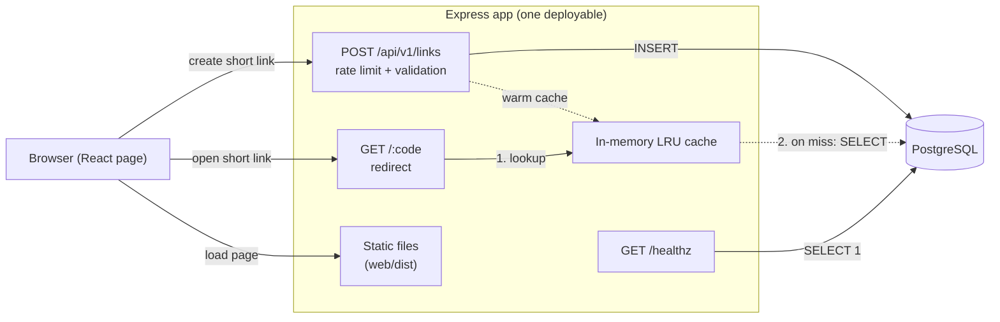
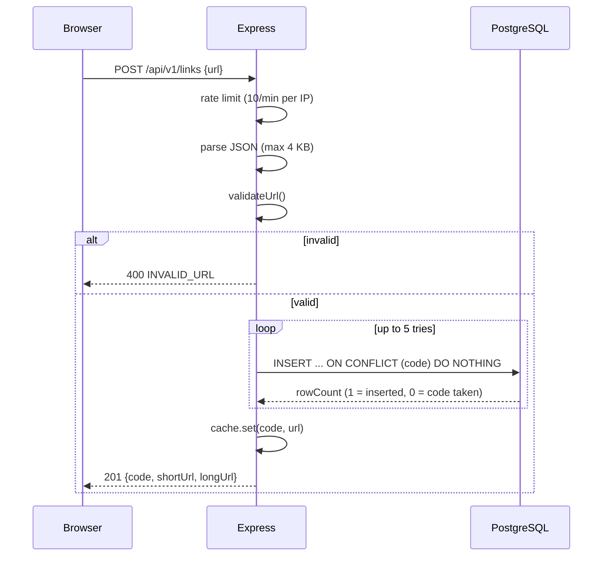
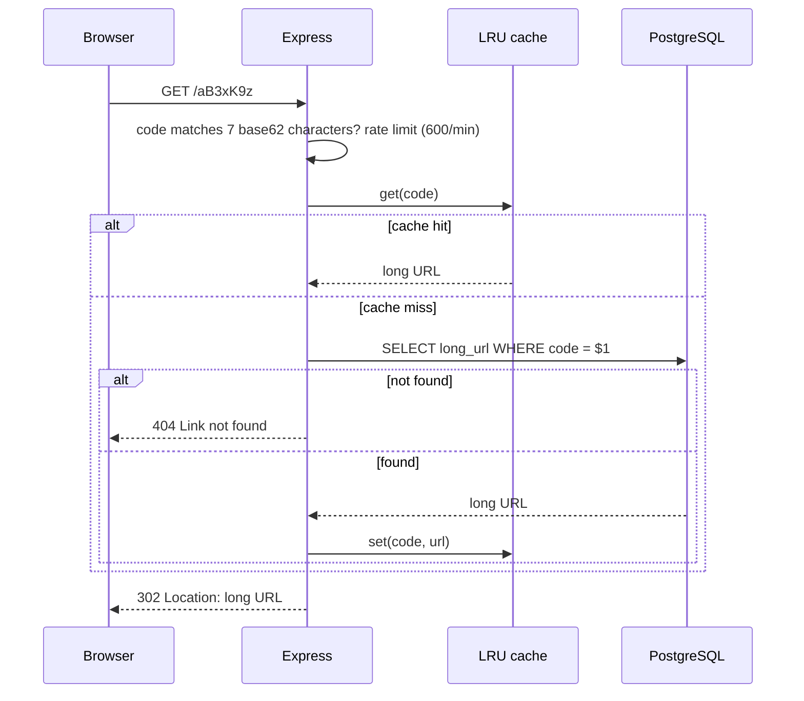
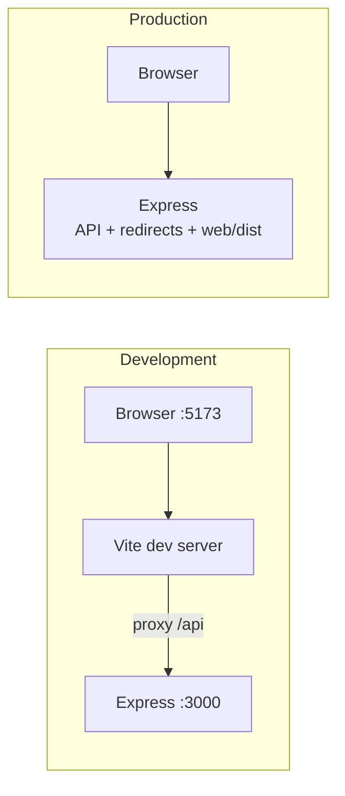

# choto: backend architecture and build guide

choto ("small" in Bengali) is a URL shortener. A visitor pastes a long link into one textbox and gets a short link in a second textbox. Opening the short link redirects to the original.

This document explains the whole backend: why it is shaped the way it is, how to build it step by step, how the React page connects to it, and how it grows.

## Contents

1. [Requirements and assumptions](#1-requirements-and-assumptions)
2. [Architecture at a glance](#2-architecture-at-a-glance)
3. [Tech stack and key decisions](#3-tech-stack-and-key-decisions)
4. [Project structure](#4-project-structure)
5. [Data model](#5-data-model)
6. [API design](#6-api-design)
7. [How a request flows](#7-how-a-request-flows)
8. [Building the backend, step by step](#8-building-the-backend-step-by-step)
9. [Building the frontend and integrating it](#9-building-the-frontend-and-integrating-it)
10. [Running and testing locally](#10-running-and-testing-locally)
11. [Deployment](#11-deployment)
12. [Security](#12-security)
13. [Reliability and observability](#13-reliability-and-observability)
14. [Scaling plan](#14-scaling-plan)
15. [Cost](#15-cost)
16. [Trade-offs and known weaknesses](#16-trade-offs-and-known-weaknesses)
17. [Roadmap](#17-roadmap)

---

## 1. Requirements and assumptions

| Topic | Decision |
|---|---|
| v1 scope | One page, two textboxes: long URL in, short URL out |
| Accounts | None. Anyone can create links anonymously |
| Extras | No custom aliases, expiry or analytics in v1 |
| Link lifetime | Forever. Links are immutable |
| Users | Up to about 100k in year 1 |
| Traffic | Typical 100 to 500 requests/sec. 5k requests/sec is treated as a spike ceiling (a viral link) |
| Read/write ratio | About 100:1, almost all traffic is redirects |
| Latency | p95 under 200ms end to end. The server-side target is under 50ms, since distance to the user and TLS take the rest |
| Data size | Under 1 GB in year 1 (about 100 to 300 bytes per row) |
| Constraint | Only technologies the developer already knows: JavaScript, Node.js, Express, PostgreSQL, React (basics). Redis is allowed later if needed |
| Not yet decided | Hosting provider, budget, domain. The app is host-agnostic |

## 2. Architecture at a glance

**Style: a monolith.** One Express application serves the API, the redirects and the built React page. One PostgreSQL database stores the links.

Why not microservices or serverless: the only scale pressure is redirects, and a single Node process handles thousands per second. Splitting it up adds operations work with no benefit for a solo developer, and serverless cold starts would hurt the p95 target.



The order in which Express checks routes matters, so it is fixed on purpose:

1. Security headers and request logging (every request)
2. `GET /healthz`
3. `POST /api/v1/links` (rate limit, then body parsing, then handler)
4. `GET /:code` (the redirect, only for exactly 7 letters or digits)
5. Static files from `web/dist`
6. 404 handler, then the error handler

The redirect sits before static files so the hot path (redirects) skips a filesystem lookup. `/healthz` must come before the redirect because "healthz" is also 7 characters long, so the redirect route would otherwise swallow it. The code generator never issues "healthz" as a short code for the same reason.

## 3. Tech stack and key decisions

| Layer | Choice | Alternatives considered | Why this one |
|---|---|---|---|
| Runtime | Node.js 20.6+ | Deno, Bun | You know Node. 20.6+ gives built-in `--env-file`, so no `dotenv` package |
| Framework | Express 4 | Fastify, plain `http` | Familiar and fast enough. Express 4 is pinned because some Express 5 route syntax differs |
| Database | PostgreSQL | MongoDB, Redis as the primary store | Redirects are pure key lookups, and a primary key gives atomic uniqueness for free |
| Cache | In-process LRU (a `Map`) | Redis, no cache | Links never change, so there is no invalidation problem. Redis only helps once you run several instances |
| Short code | 7 random base62 characters | Counter + base62, hash of the URL | Counters are guessable and need coordination. Hashes collide and need dedupe. 62^7 is about 3.5 trillion, so collisions are negligible |
| Redirect status | 302 | 301 | Browsers cache 301s forever, so you could never delete a link or count clicks later |
| Frontend | React + Vite, served by Express | Plain HTML/JS, Next.js | Your preference. Same origin as the API, so no CORS setup |
| Queue, search, object storage | None | n/a | Nothing in v1 needs them |
| Dependencies | `express`, `pg` only | Helmet, express-rate-limit, dotenv | Fewer packages, and each replaced one is under 30 lines |

## 4. Project structure

```
choto/
├── src/
│   ├── server.js            app wiring, route order, logging, shutdown
│   ├── config.js            reads environment variables
│   ├── db.js                pg pool, createLink(), findLongUrl()
│   ├── code.js              short-code generator, CODE_RE, reserved codes
│   ├── cache.js             LRU class with TTL
│   ├── cacheInstance.js     the one shared cache instance
│   ├── validate.js          validateUrl()
│   ├── middleware/
│   │   └── rateLimit.js     per-IP fixed-window limiter
│   └── routes/
│       ├── links.js         POST /api/v1/links
│       └── redirect.js      GET /:code
├── migrations/
│   └── 001_create_links.sql
├── scripts/
│   └── migrate.js           applies numbered .sql files once each
├── test/
│   └── core.test.js         node --test unit tests
├── web/                     React + Vite page
│   ├── index.html
│   ├── vite.config.js       dev proxy for /api
│   └── src/ (main.jsx, App.jsx, styles.css)
├── .github/workflows/ci.yml
├── .env.example
└── package.json
```

Boundaries: only `db.js` talks to PostgreSQL, and only the routes use the cache. `validate.js`, `code.js` and `cache.js` have no side effects and no imports from the rest of the app, which is why they can be unit tested without a database.

## 5. Data model

One table, no relationships in v1.

```sql
CREATE TABLE links (
  code       VARCHAR(7)  PRIMARY KEY,
  long_url   TEXT        NOT NULL CHECK (char_length(long_url) <= 2048),
  created_at TIMESTAMPTZ NOT NULL DEFAULT now()
);
```

- The primary key on `code` is the only index needed. It enforces uniqueness and serves every redirect lookup.
- The `CHECK` constraint matches the 2048-character limit in the validator, so bad data cannot get in even if the validator has a bug.
- Sizing: 10 million rows is roughly 2 to 3 GB, comfortable for one PostgreSQL instance.
- Likely future columns: `expires_at`, `disabled`, `user_id`, `click_count`.

Migrations are numbered `.sql` files in `migrations/`. `scripts/migrate.js` records each applied file in a `schema_migrations` table and runs each new file inside a transaction, so a failed migration leaves nothing half applied.

## 6. API design

REST, JSON, under `/api/v1`. The redirect route is at the root and is never versioned, because short links that were shared or printed must keep working forever.

| Method and path | Purpose | Success | Errors |
|---|---|---|---|
| `POST /api/v1/links` | Create a short link | `201` | `400 INVALID_URL`, `413` body too large, `429 RATE_LIMITED`, `500 INTERNAL` |
| `GET /:code` | Redirect to the long URL | `302` | `404` plain text "Link not found", `429` |
| `GET /healthz` | Health check (runs `SELECT 1`) | `200 {"ok":true}` | `503 {"ok":false}` |

Create a link:

```http
POST /api/v1/links
Content-Type: application/json

{ "url": "https://example.com/some/very/long/path?x=1" }
```

```http
201 Created

{
  "code": "aB3xK9z",
  "shortUrl": "https://choto.example/aB3xK9z",
  "longUrl": "https://example.com/some/very/long/path?x=1"
}
```

Every API error has the same shape, which is what the frontend relies on:

```json
{ "error": { "code": "INVALID_URL", "message": "Enter a full link starting with http:// or https:// (up to 2048 characters)." } }
```

Rules and limits:

- **Validation:** `new URL()` must parse it. Only `http:` and `https:` are allowed. Maximum 2048 characters (checked before and after normalization). Credentials in the URL (`user:pass@`) are rejected. A URL pointing at choto's own domain is rejected, to prevent redirect loops.
- **Rate limits:** 10 creates per minute per IP, and 600 redirects per minute per IP. The redirect limit is loose because many people share one IP (offices, mobile carriers).
- **Body limit:** 4 KB.
- **Pagination:** none, because there is no list endpoint.
- **Idempotency:** none. A double click creates two codes, which is harmless. The page disables the button while a request is running.
- **Authentication:** none in v1.

## 7. How a request flows

### Creating a short link



### Opening a short link



## 8. Building the backend, step by step

This is the order the project was built in. Each step can be run and tested before moving on. The finished code is in the zip, so use these steps to understand it or to rebuild it yourself.

### Step 1: Initialize the project

```bash
mkdir choto && cd choto
npm init -y
npm install express@4 pg
```

In `package.json`, set `"type": "module"` (ES modules), `"engines": { "node": ">=20.6" }`, and these scripts:

```json
"scripts": {
  "dev": "node --env-file=.env --watch src/server.js",
  "start": "node src/server.js",
  "migrate": "node scripts/migrate.js",
  "migrate:local": "node --env-file=.env scripts/migrate.js",
  "build": "npm --prefix web install --include=dev && npm --prefix web run build",
  "test": "node --test"
}
```

`start` and `migrate` read real environment variables (what hosting platforms provide). `dev` and `migrate:local` load a local `.env` file.

### Step 2: Configuration

`.env` (copy from `.env.example`, never commit it):

```
DATABASE_URL=postgres://localhost:5432/choto
PORT=3000
BASE_URL=http://localhost:3000
TRUST_PROXY=1
CACHE_MAX=50000
CACHE_TTL_MS=300000
```

`src/config.js` reads these once, strips a trailing slash from `BASE_URL`, derives the `ownHost` used to reject self-referencing links, and throws immediately if `DATABASE_URL` is missing. Failing at startup is better than failing on the first request.

`BASE_URL` is how short links are built (`${BASE_URL}/${code}`), so changing domains later means changing one value.

### Step 3: Database and migration

```bash
createdb choto
```

Create `migrations/001_create_links.sql` (the schema in section 5) and `scripts/migrate.js`, which:

1. Creates the `schema_migrations` table if needed.
2. Reads `migrations/*.sql` in name order.
3. Skips files already recorded, and runs each new file in a transaction together with its bookkeeping row.

```bash
npm run migrate:local
```

To change the schema later, add `002_...sql`. Never edit a migration that has already been applied.

### Step 4: The pure building blocks

Write these first, because they have no dependencies and can be tested immediately.

**`src/code.js`**: generates 7 random base62 characters with `crypto.randomInt` (cryptographically random, not `Math.random`). It exports `CODE_RE` (`/^[0-9A-Za-z]{7}$/`) and avoids a small reserved set (`healthz`).

**`src/validate.js`**: `validateUrl(input, ownHost)` returns `{ ok: true, url }` with the normalized URL, or `{ ok: false }`. It enforces the rules listed in section 6.

**`src/cache.js`**: an LRU built on `Map`. A `Map` remembers insertion order, so on every `get` the entry is deleted and re-inserted to mark it most recently used, and on `set` the first key (the oldest) is evicted when the size exceeds the limit. Each entry has an expiry time (default 5 minutes). The cache also counts hits and misses for the logs. `src/cacheInstance.js` creates the single shared instance from the config.

**`src/middleware/rateLimit.js`**: a fixed-window counter per IP. It stores `{count, reset}` in a `Map`, returns `429` with a `Retry-After` header when the count passes the maximum, and clears expired entries on a timer (`unref()`'d so it never keeps the process alive).

```bash
npm test      # runs test/core.test.js: validation, code format, LRU eviction and expiry
```

### Step 5: Database access

`src/db.js` creates one `pg.Pool` and exposes two functions.

```js
export const pool = new pg.Pool({
  connectionString: config.databaseUrl,
  max: 10,                       // connections
  connectionTimeoutMillis: 2000, // fail fast if the pool is exhausted
  statement_timeout: 3000,       // no query may hang the request
});

export async function createLink(longUrl) {
  for (let i = 0; i < 5; i++) {
    const code = newCode();
    const { rowCount } = await pool.query(
      'INSERT INTO links (code, long_url) VALUES ($1, $2) ON CONFLICT (code) DO NOTHING',
      [code, longUrl]
    );
    if (rowCount === 1) return code;   // inserted, so the code was free
  }
  throw new Error('could not generate a unique code');
}

export async function findLongUrl(code) {
  const { rows } = await pool.query('SELECT long_url FROM links WHERE code = $1', [code]);
  return rows[0]?.long_url ?? null;
}
```

Collisions are handled by the database, not by checking first and inserting second (which would race). `ON CONFLICT DO NOTHING` plus the row count makes it atomic. All queries use `$1` placeholders, so SQL injection is not possible through these paths.

### Step 6: The two routes

**`POST /api/v1/links`** (`src/routes/links.js`): validate, call `createLink`, warm the cache, respond `201`. Invalid input returns `400 INVALID_URL`. Any other error goes to the central error handler with `next(err)`.

**`GET /:code`** (`src/routes/redirect.js`):

```js
redirectRouter.get(
  '/:code',
  (req, res, next) => (CODE_RE.test(req.params.code) ? next() : next('route')),
  limiter,
  async (req, res, next) => {
    try {
      let url = cache.get(req.params.code);
      if (!url) {
        url = await findLongUrl(req.params.code);
        if (!url) return res.status(404).type('text/plain').send('Link not found');
        cache.set(req.params.code, url);
      }
      res.redirect(302, url);
    } catch (err) { next(err); }
  }
);
```

The first handler checks the format and calls `next('route')` if it is not exactly 7 base62 characters, so paths like `/favicon.ico` skip this route entirely without touching the rate limiter or the database. The `try/catch` with `next(err)` is deliberate: Express 4 does not catch rejected promises on its own.

### Step 7: Wire it together

`src/server.js` does the following, in this order:

1. `app.set('trust proxy', config.trustProxy)`. Behind a hosting proxy, `req.ip` would otherwise be the proxy's address and every visitor would share one rate-limit bucket.
2. A small middleware that sets `X-Content-Type-Options: nosniff` and `Referrer-Policy: no-referrer`, and logs one JSON line per request when it finishes (method, route, status, milliseconds, cache stats). It never logs the long URL, because query strings can contain tokens.
3. `/healthz`, then `/api/v1/links` (`rateLimit` then `express.json({ limit: '4kb' })` then the router), then the redirect router, then `express.static('web/dist')`.
4. A 404 handler and an error handler. The error handler returns the standard error shape, with a generic message for server errors so internals never leak.
5. Graceful shutdown: on `SIGTERM` or `SIGINT`, stop accepting connections, let in-flight requests finish, close the pool, and force-exit after 10 seconds. Hosting platforms send `SIGTERM` on every deploy.

### Step 8: Verify the backend without the frontend

With the server running (`npm run dev`):

```bash
# create
curl -s -X POST http://localhost:3000/api/v1/links \
  -H 'Content-Type: application/json' \
  -d '{"url":"https://example.com/hello?x=1"}'

# redirect (replace CODE with the code from above); expect 302 and a Location header
curl -i http://localhost:3000/CODE

# validation: each of these should return 400
curl -s -X POST http://localhost:3000/api/v1/links -H 'Content-Type: application/json' -d '{"url":"javascript:alert(1)"}'
curl -s -X POST http://localhost:3000/api/v1/links -H 'Content-Type: application/json' -d '{"url":"not a url"}'

# health
curl -i http://localhost:3000/healthz
```

Send 11 creates in a minute and the 11th should return `429`.

## 9. Building the frontend and integrating it

### The integration model: one origin

In production, Express serves the built React files itself, so the page and the API live on the same origin (for example `https://choto.example`). That means:

- The page calls `fetch('/api/v1/links')` with a relative URL.
- No CORS configuration is needed.
- There is one deployment, not two.

In development there are two servers, because Vite gives hot reload but does not know about your API. The Vite dev server proxies API calls to Express, so the page code is identical in both modes.



### Step 1: Create the React app

```bash
cd web
npm install react react-dom
npm install -D vite @vitejs/plugin-react
```

`web/vite.config.js`:

```js
import { defineConfig } from 'vite';
import react from '@vitejs/plugin-react';

export default defineConfig({
  plugins: [react()],
  server: { proxy: { '/api': 'http://localhost:3000' } },
});
```

`web/index.html` holds a `<div id="root">` and loads `/src/main.jsx`. `main.jsx` renders `<App />`.

### Step 2: The page and its API contract

`App.jsx` keeps five pieces of state: the input `url`, the returned `short` link, an `error` message, a `busy` flag and a `copied` flag. The submit handler is the entire integration:

```jsx
async function shorten(e) {
  e.preventDefault();
  if (busy) return;
  setBusy(true); setError(''); setCopied(false);
  try {
    const res = await fetch('/api/v1/links', {
      method: 'POST',
      headers: { 'Content-Type': 'application/json' },
      body: JSON.stringify({ url }),
    });
    const data = await res.json().catch(() => ({}));
    if (!res.ok) {
      setShort('');
      setError(data.error?.message || 'Something went wrong. Try again.');
      return;
    }
    setShort(data.shortUrl);
  } catch {
    setShort('');
    setError('Could not reach the server. Check your connection and try again.');
  } finally {
    setBusy(false);
  }
}
```

How each backend outcome shows up in the page:

| Backend response | What the user sees |
|---|---|
| `201` with `shortUrl` | The short link fills the second textbox, Copy button enables |
| `400 INVALID_URL` | The server's message appears under the form |
| `429 RATE_LIMITED` | "Too many requests. Try again in a minute." |
| `413` or `500` | The server's generic message, or "Something went wrong" |
| Network failure | "Could not reach the server..." |

Because every error uses the same `{ error: { code, message } }` shape and the messages are written for end users, the frontend never needs a mapping table. The backend owns the wording.

The second textbox is `readOnly` and selects its text on focus, so even if the clipboard API is blocked the visitor can copy by hand. The Copy button uses `navigator.clipboard.writeText` and shows "Copied" for 2 seconds.

### Step 3: Styling

`styles.css` uses CSS variables for colors, with a `prefers-color-scheme: dark` block that swaps them. The page already follows the visitor's system theme. The short-link field is only as wide as its content (`width: fit-content`), so the output is visibly smaller than the input.

### Step 4: Build for production

```bash
npm run build      # from the project root: installs web deps, runs vite build
```

Vite writes `web/dist/`. `server.js` serves that folder with `express.static`. Vite fingerprints asset filenames, so browsers can cache them safely.

Important details of the integration:

- **Route order protects both sides.** `/api/...` and `/healthz` are matched first, then 7-character codes, then static files. The page at `/` is just `index.html` from static.
- **Short link domain.** `shortUrl` in the response is built from the server's `BASE_URL`, not from the browser's address. In production, set `BASE_URL` to the real domain or the page will show `localhost` links.
- **If you add more pages later,** a path with exactly 7 letters or digits (`/pricing` is one, for example) would be treated as a short code. Either keep other page paths out of that pattern, prefix them (`/p/pricing`), or reserve them in `code.js` and handle them before the redirect route.

### Step 5: The light/dark toggle (future)

The CSS variables make this frontend-only work. Add a button that sets `document.documentElement.dataset.theme = 'light' | 'dark'`, store the choice in `localStorage`, and add `:root[data-theme='dark'] { ... }` rules that mirror the dark media query. No backend changes.

## 10. Running and testing locally

```bash
createdb choto
cp .env.example .env            # check DATABASE_URL
npm install
npm run migrate:local
npm run dev                     # API and redirects on http://localhost:3000

# second terminal, React page with hot reload on http://localhost:5173
npm --prefix web install
npm --prefix web run dev
```

Or build the page once and use only `http://localhost:3000`:

```bash
npm run build && npm run dev
```

Automated tests:

```bash
npm test
```

The unit tests cover URL validation (including `javascript:`, `data:`, `ftp:`, credentials, over-length and self-referencing URLs), short-code format, and LRU eviction and expiry. They need no database. Route-level behavior is checked with the `curl` commands in section 8.

Common problems:

| Symptom | Likely cause |
|---|---|
| `DATABASE_URL is required` on start | `.env` missing, or you ran `npm start` locally (use `npm run dev`) |
| `relation "links" does not exist` | Migration not run |
| Page shows but "Shorten" gives a network error | Express not running, or Vite proxy target port differs from `PORT` |
| Short links show `localhost` in production | `BASE_URL` not set on the host |
| Every visitor gets rate limited together | `TRUST_PROXY` not set while behind a proxy |
| SSL error connecting to a hosted database | Add `?sslmode=require` to `DATABASE_URL` |

## 11. Deployment

The app needs only Node 20.6+, a PostgreSQL database and HTTPS. Any host that provides those works, so the provider decision can wait.

1. Create a managed PostgreSQL database and copy its connection string.
2. Create a Node web service from your Git repository.
3. Build command: `npm install && npm run build`
4. Start command: `npm run migrate && npm start` (migrations are safe to repeat, since applied ones are skipped).
5. Environment variables: `DATABASE_URL` (with `?sslmode=require` if needed), `BASE_URL` (your public domain, no trailing slash), `TRUST_PROXY=1`.
6. Point your domain at the service and confirm HTTPS works.
7. Enable daily database backups, then do one test restore before launch.
8. Add a free uptime monitor on `/healthz`.

CI (`.github/workflows/ci.yml`) runs `npm test` and `npm run build` on every push and pull request. Most hosts can auto-deploy from `main` once CI is green. There are two environments, local and production. Skip staging until the app has users.

The short domain is a long-term commitment, since every link you ever issue depends on it. Turn on auto-renew, buy multiple years if you can, and compare second-year renewal prices, not just the first year.

## 12. Security

| Threat | Mitigation |
|---|---|
| Abuse of anonymous creation (phishing, malware links) | The biggest real risk. v1 has rate limiting only. Add a `disabled` flag, a report path and a link-safety check next |
| `javascript:` and `data:` URLs | Only `http:` and `https:` are accepted |
| SQL injection | Parameterized queries only |
| Redirect loops | URLs on choto's own domain are rejected |
| Oversized requests | JSON body limit of 4 KB, URL limit of 2048 characters |
| Credentials leaking in URLs | `user:pass@` URLs are rejected |
| SSRF | Not applicable: the server never fetches the submitted URL. Keep it that way |
| XSS | React escapes output. The API returns JSON, and 404 responses are plain text |
| Enumeration of links | Random 7-character codes make guessing impractical, but short links are not secret |
| Log leakage | The long URL is never logged |
| Secrets | `DATABASE_URL` lives in environment variables. `.env` is in `.gitignore` |
| Transport | HTTPS is terminated by the hosting platform |

## 13. Reliability and observability

Failure behavior:

| Failure | Result |
|---|---|
| Database down | Cached links still redirect. Creating links and uncached redirects return an error. `/healthz` returns `503` |
| Connection pool exhausted | Requests fail after 2 seconds instead of hanging |
| Slow query | Cancelled after 3 seconds |
| Process crash | The platform restarts it. The cache starts empty, so there is a brief increase in database reads |
| Deploy | `SIGTERM` is handled, so in-flight requests finish before exit |
| Code collision | Retried up to 5 times, then a `500` |

Retries exist only for code collisions. There are no circuit breakers because there is only one dependency.

Observability:

- **Logs:** one JSON line per request to stdout: timestamp, method, route, status, milliseconds, and cache hits, misses and size.
- **Metrics:** use the host's CPU, memory and response-time graphs. The cache hit rate comes from the logs.
- **Tracing:** not needed with one service.
- **Alerts:** an uptime monitor on `/healthz`, plus the host's alerts for 5xx rate and database connections or CPU.

## 14. Scaling plan

Where it breaks first, in order:

1. **One Node process (CPU)** at a few thousand requests per second. Run 2 to 4 instances.
2. **Database reads during a spike.** A viral link is a hot key, so the LRU cache absorbs most of it. At a 90% hit rate, 5k requests/sec means about 500 reads/sec to PostgreSQL, which is fine.
3. **Per-instance caches.** With several instances, each warms its own cache and hit rates drop. Nothing becomes incorrect, because links are immutable.

| Load | What to do |
|---|---|
| Launch up to 5k/sec spikes | 1 to 2 instances, LRU cache, one small PostgreSQL |
| 10x | Redis as a shared cache, 2 to 4 instances, a CDN in front of redirects |
| 100x | PostgreSQL read replica, CDN caching of redirects at the edge, likely a key-value store for the hot path |

The rate limiter is also per instance, so with N instances the effective limit is up to N times higher. Move it to Redis at the same time as the shared cache.

If you later add click counts, never write to the database on every redirect. Buffer counters in memory and flush them in batches every few seconds.

## 15. Cost

These are rough ballparks from general knowledge, not current prices. Check your provider's pricing page.

| Stage | Monthly |
|---|---|
| Launch / MVP | About $0 to 15 for an app plus a small PostgreSQL, plus a domain at roughly $10 to 15 per year |
| About 10x | About $30 to 80 |
| About 100x | About $200 to 600 or more |

## 16. Trade-offs and known weaknesses

- **302 redirects** mean every click hits your server. In exchange you can delete links and add analytics later.
- **No URL deduplication:** the same URL submitted twice gets two codes. This keeps writes simple.
- **In-memory cache and rate limiter** reset on restart and are not shared across instances.
- **Anonymous creation invites abuse.** Expect spam before you expect heavy load.
- **A managed platform** costs more per unit than a plain VPS, but saves you from learning server administration.
- **Hosting region vs. user location** will affect the 200ms target more than any code optimization.
- **No end-to-end tests** in v1, only unit tests plus manual `curl` checks.

## 17. Roadmap

| Phase | Build |
|---|---|
| **MVP (this repo)** | Schema, create and redirect routes, validation, rate limiting, LRU cache, React page with copy button, health check, CI, deploy |
| **Growth** | Light/dark toggle, `disabled` flag with a report/takedown path, link-safety check, basic click counter (buffered writes) |
| **Scale** | Redis shared cache and rate limiter, multiple instances, CDN in front of redirects, read replica |

When accounts arrive: add a `users` table and a `user_id` column on `links`, with session cookies or JWTs. The authorization model would be simple: owners manage their own links, everyone else is anonymous.
